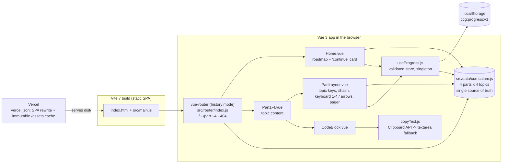

# Claude Code Guide (Claude Code 마스터)

A four-part, Korean-language study guide that teaches backend developers how to use Claude Code in daily API, testing and deployment work, with copy-ready examples and progress saved in the browser.

Live: <https://claude-code-guide-ashy.vercel.app>

## Problem

Tips for terminal-based AI coding tools are usually scattered across blog posts. They don't fit together into an order you can follow, and you can't tell how far you've got.
This site turns a blog series ([MemoryHub](https://memoryhub.tistory.com)) into a structured course: 4 parts × 4 topics, each topic linkable, each example copyable.
It remembers which topics you finished and where you stopped, with no account and no backend.

## Architecture



Details: [`docs/architecture.md`](docs/architecture.md)

## Key technical decisions

- **One curriculum file drives everything.** The nav, home roadmap, topic keys, prev/next pager and progress validation all read `src/data/curriculum.js`, so adding a topic to the outline is one edit (commit `ad93dbf`). See [ADR 0001](docs/adr/0001-curriculum-as-single-source-and-hash-topics.md).
- **Topics are URL hashes, not routes.** `/part2#commit` is shareable. `resolveTopic` falls back to the first topic for unknown hashes, and the router's `scrollBehavior` keeps the page from jumping when only the hash changes (`src/router/index.js`, `src/components/PartLayout.vue`).
- **Progress is local and defensive.** `parseProgress` drops corrupt JSON, unknown topics and duplicates. When storage is blocked (private mode, quota), the store keeps working in memory (`src/composables/useProgress.js`). See [ADR 0002](docs/adr/0002-local-only-validated-progress-store.md).
- **Copy works in insecure or locked-down contexts.** `copyText` tries `navigator.clipboard`, then a hidden textarea with `execCommand('copy')`. If both fail, `CodeBlock.vue` selects the code and tells the reader to press Ctrl/⌘+C (`src/composables/copyText.js`).
- **Deep links on a static host.** Vue Router history mode, with `vercel.json` rewriting every path to `index.html`. Hashed `/assets/*` files get a one-year immutable cache.

## Run locally

Node 22 (Vite 7 needs Node 20.19+), npm.

```bash
npm ci
npm run dev       # http://localhost:5173
npm test          # vitest run
npm run build     # -> dist/
npm run preview   # serve dist/
```

## Testing

On 2026-10-28, `npm test` (Vitest 3.2.7, Node 22.19) reported **14 passed / 0 failed / 0 skipped** across 2 files:

| File | Covers | Tests |
|---|---|---|
| `tests/navigation.test.js` | curriculum shape, every topic has a content panel in its `PartN.vue`, hash → topic resolution, part order, `copyText` clipboard and textarea fallback paths | 8 |
| `tests/progress.test.js` | parsing corrupt/unknown data, persistence and reload, toggling, blocked/throwing storage, reset | 6 |

`npm run build` succeeds. `.github/workflows/ci.yml` runs `npm ci`, `npm test` and `npm run build` on every pull request and every push to `main`. There is no lint configuration, and the Vue components have no component or E2E tests.

## Limitations and next steps

- Lesson content lives inside `Part1-4.vue` as template markup and string constants, not as data. Only the outline is in `curriculum.js`, so editing content means editing components.
- The four part views are imported eagerly in `src/router/index.js`, so the whole guide ships as one JS bundle (157 KB, 58 KB gzip on 2026-10-28). Route-level lazy loading would split it.
- Page titles in `src/router/index.js` (`meta.title`) repeat the part titles instead of reading `curriculum.js`, so a renamed part needs two edits.
- Progress is per browser. Nothing syncs across devices.
- `src/components/HelloWorld.vue` and `src/assets/vue.svg` are unused Vite template leftovers.
- The UI copy is Korean only.

## Project docs

- [`docs/architecture.md`](docs/architecture.md): components, data flow, failure handling
- [`docs/adr/`](docs/adr/): decision records
- `PRODUCT.md`: audience and purpose. `DESIGN.md`: the keycap design system. [`docs/asset-register.md`](docs/asset-register.md): image provenance (all generated, prompts embedded)

## Project structure

```
src/
  data/curriculum.js        parts, topics, SITE_NAME, SOURCE_URL, resolveTopic, neighbours
  composables/              useProgress.js (progress store), copyText.js
  components/               PartLayout, CodeBlock, TopicHead, Tip
  views/                    Home, Part1-4, NotFound
  router/index.js           routes, scrollBehavior, document titles
tests/                      Vitest unit tests
public/images/              generated hero, 404 and OG images (+ prompt sidecars)
vercel.json                 SPA rewrite, asset cache headers
```

## License

No license file. The previous README said "Private project", so treat it as all rights reserved. Guide content is based on the MemoryHub blog series.

## 한국어 요약

백엔드 개발자를 위한 Claude Code 실전 가이드입니다. 4개 파트 × 4개 주제를 키보드 키 모양 UI로 탐색하고, 주제마다 링크(`/part2#commit`)를 공유할 수 있습니다. 예제 코드는 버튼 한 번으로 복사하고, 완료 표시와 마지막 위치는 브라우저(localStorage)에 저장됩니다. Vue 3 + Vite 정적 SPA로 Vercel에 배포되며, 단위 테스트 14개와 GitHub Actions CI가 있습니다.
